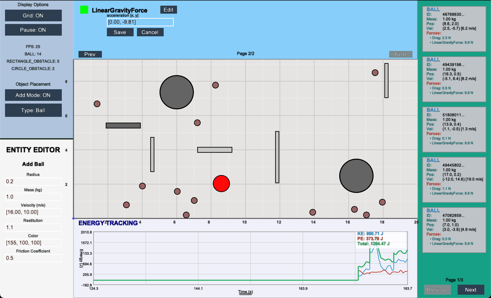
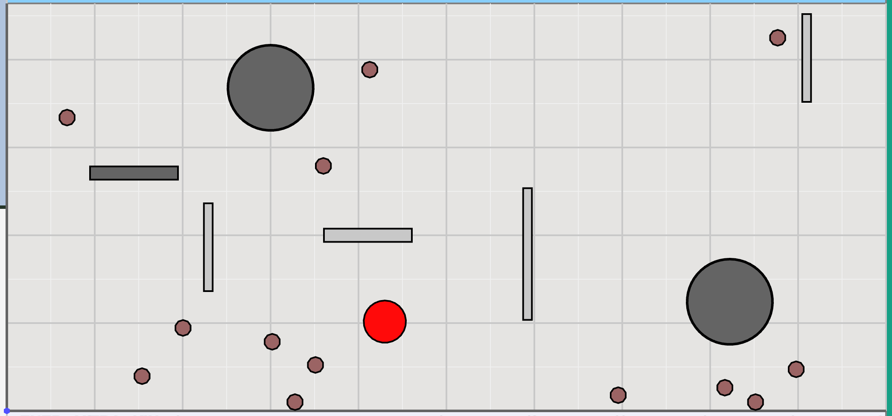
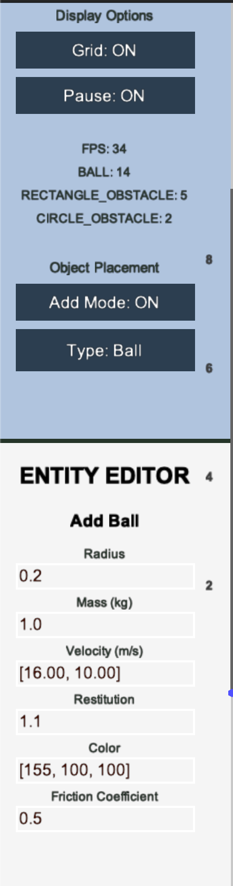
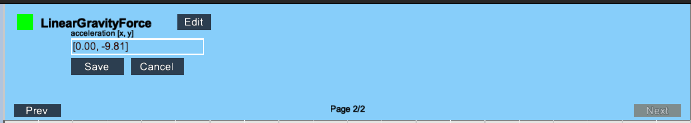
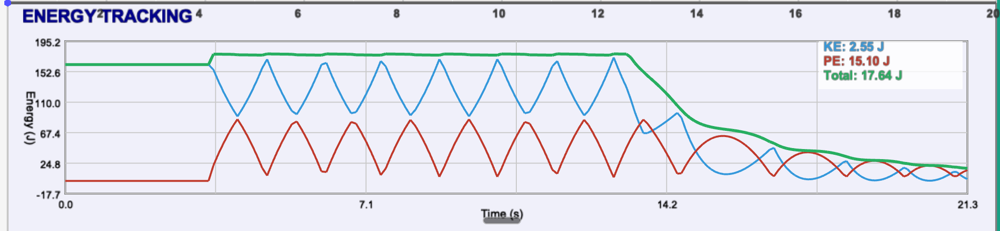
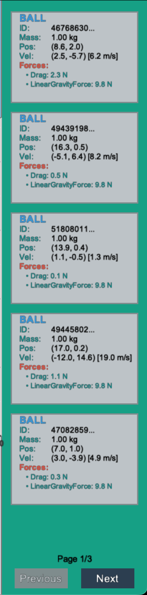

# ViewPort (center)
- Main view on the simulation

# Control Panel (Left)

## Controls
- Pause
- Display Grid

## Debugs
- FPS
- Entitys count

## Entity Editor
- Add Entity / Edit Parameters
- Place them by click on ViewPort

# Force Manager (Top Center)

- Allows to activate/deactivate forces
- Allows to edit force parameters / calculations models

# Energy Manager (Bottom Center)

- Displays Plots of Potential and Kinectc energy over time

# Inventory Panel (Right)

- Allows to see paramenters of all entities in simulation.

# Framework
The UI is built with [Kivy](https://kivy.org) (`kivy>=2.3.1`):
- `physics_sim/simulation/simulator.py` - `Simulator` (a `kivy.app.App`) owns the
  update loop (`kivy.clock.Clock`), input handling and data flow between the
  engine and the panels.
- `physics_sim/rendering/kivy_renderer.py` - `KivyRenderer` draws the grid,
  force field/overlays and entities with Kivy canvas instructions.
- `physics_sim/ui/sections/*` - one Kivy widget per panel. The viewport is a
  `StencilView`, so simulation drawing never paints over other panels. Panels with
  potentially long content (controls, entity editor, force editor, inventory cards)
  are scrollable, so every widget stays reachable at any window size.

All numeric values are displayed with two decimal places.

# Mouse & Keyboard
| Input | Action |
|-------|--------|
| Left click (Add Mode ON) | Place the entity configured in the Entity Editor |
| Left click (paused) | Select an entity and load it into the Entity Editor |
| `A` | Toggle Add Mode |
| `Tab` | Cycle entity type (Add Mode) |
| `G` | Toggle grid |
| `F` | Toggle force vectors |
| `Space` | Pause / resume |
| `Esc` | Leave Add Mode, otherwise quit |

Shortcuts are ignored while a text field has keyboard focus. Pressing `Enter` in an
Entity Editor field (edit mode) or a force parameter field saves the changes.
